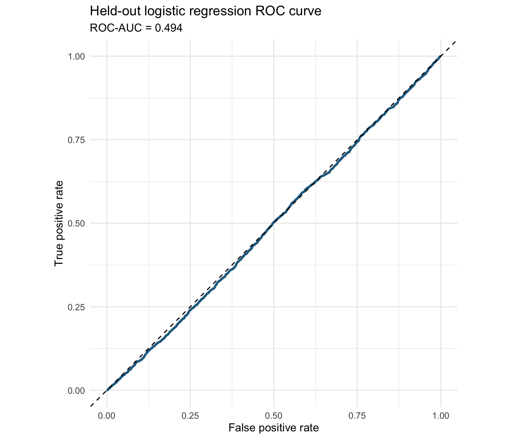
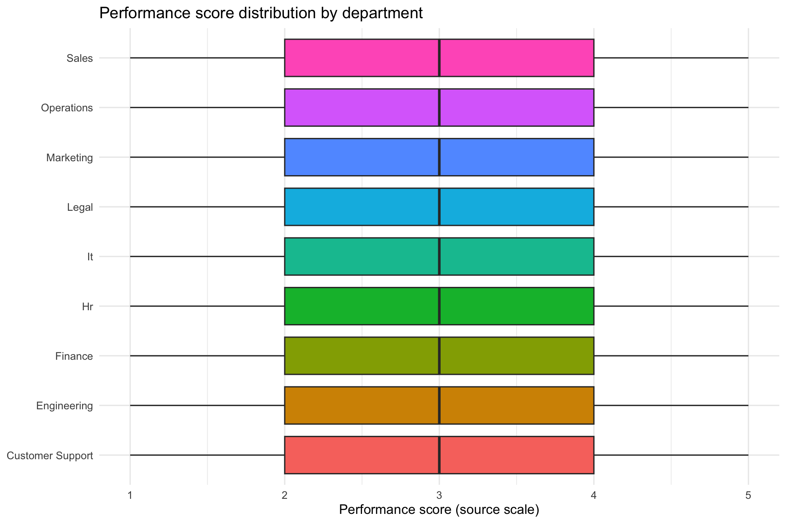
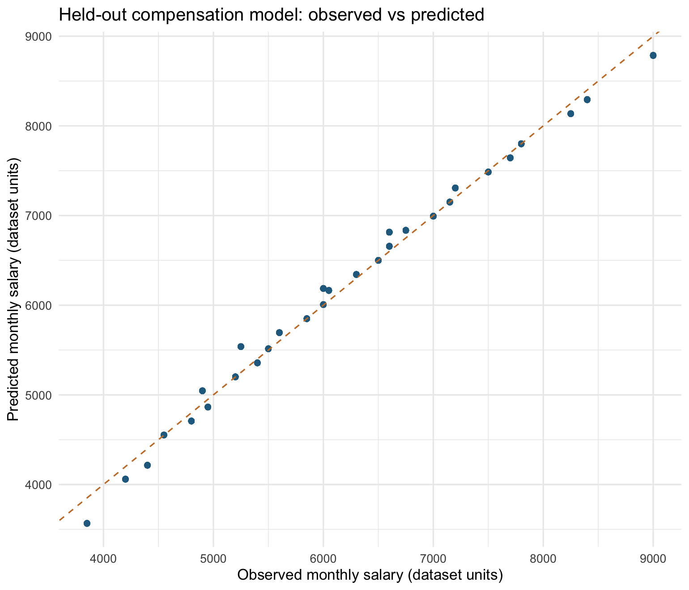
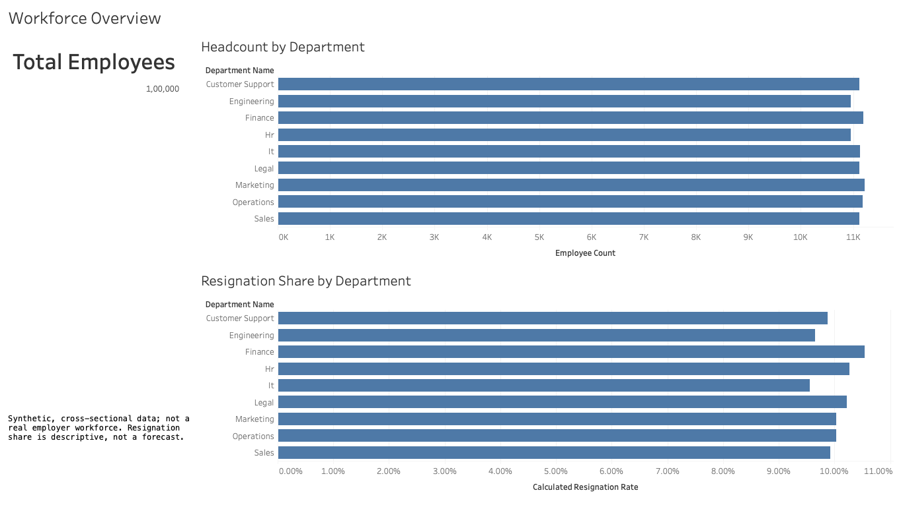
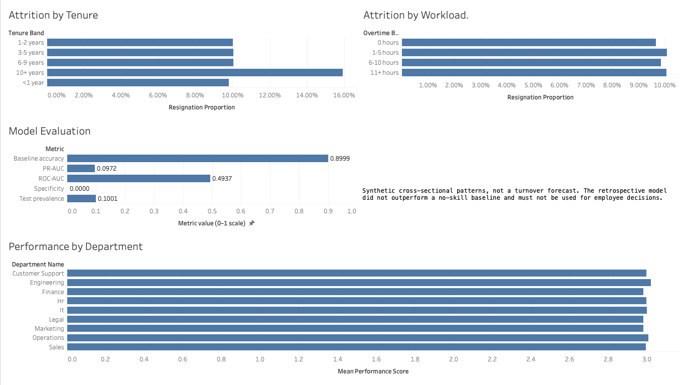
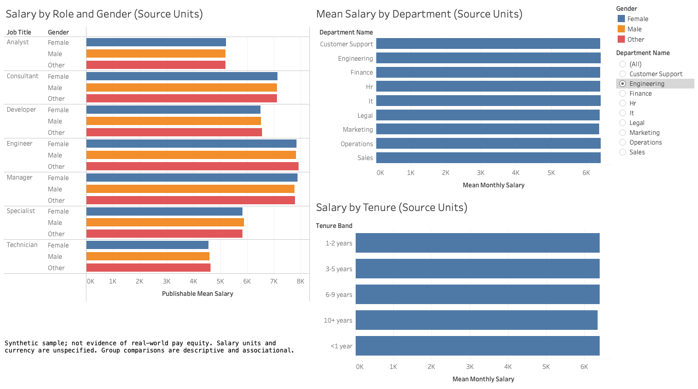

# End-to-End HR Analytics

**Employee Attrition Prediction, Workforce Performance & Compensation Equity**  
BA4301 Big Data Analytics project | PostgreSQL · R · Tableau Public

## 1. Executive summary

This project builds an auditable SQL-to-R-to-Tableau workflow on a 100,000-row, 20-field synthetic employee dataset. SQL validates, types and normalizes the source into a relational employee schema and creates analysis-ready aggregate views. R performs exploratory analysis, evaluates a retrospective attrition classifier and estimates a compensation regression. Three local Tableau dashboards are built for workforce overview, attrition/performance, and compensation equity.

The student confirmed that the instructor approved the synthetic-data exception. The source is synthetic and cross-sectional: its results are educational examples, not evidence about any employer. The classifier did not beat a simple baseline and must not be used to score employees. Tableau Public is installed. The packaged workbook is published with all three dashboard tabs visible. [Open the Tableau Public workbook](https://public.tableau.com/app/profile/anshu.lihitkar/viz/HRAnalyticsWorkforceAttritionCompensation/CompensationEquity).

## 2. Dataset and stack

The source CSV is `data/raw/Extended_Employee_Performance_and_Productivity_Data.csv`, downloaded by the student from [Kaggle: Employee Performance and Productivity Data](https://www.kaggle.com/datasets/mexwell/employee-performance-and-productivity-data). It contains 100,000 records and 20 fields; employee IDs are unique and the source has no blank values in the local validation. The faculty approval was user-confirmed. Kaggle dataset metadata lists CC0: Public Domain (checked 22 November 2026). Raw and row-level files are excluded from Git; the packaged workbook contains aggregate-only extracts.

- **PostgreSQL:** text staging, type validation, cleaning, normalized dimensions, one-to-one employee facts, analytical views, reconciliation, CSV export.
- **R 4.6:** project-local package library (`r_lib/`), EDA and plots, logistic classification with held-out evaluation, compensation regression and diagnostics.
- **Tableau Public for Apple silicon:** three dashboard specifications and aggregate-only Tableau extracts. Do not connect employee-level exports.

Salary currency/units are unspecified by the source. No event date, resignation date, or predictor observation timestamps are provided.

## 3. Data workflow

```text
Synthetic source CSV (100k × 20)
  → PostgreSQL text staging + source quality/missingness audit
  → normalized department/job-role dimensions + employee/workforce/performance/compensation tables
  → one-row-per-employee ABT + aggregate SQL views
  → R EDA and held-out models
  → aggregate-only Tableau exports → 3 interactive dashboards
```

Run `scripts/run_all.sh` after setting PostgreSQL connection environment variables (see [setup guide](docs/SETUP_AND_TABLEAU.md)). Tables/views are defined in `sql/01_schema_setup.sql` through `sql/04_verification.sql`. The main analysis grain is one employee per ABT row; department, role, workstyle and pay views declare coarser grains. The row-level ABT, salary rank and test predictions are local-only.

## 4. SQL highlights

The pipeline keeps the raw CSV in a text staging table, records field missingness, validates dates and business ranges before casting, deduplicates IDs deterministically, normalizes department/job-role dimensions, and loads related employee facts. SQL uses joins, `CASE`, `COALESCE`, CTEs, grouping and window functions (`ROW_NUMBER`, `RANK`, `DENSE_RANK`, and partitioned calculations). Verification reconciles source/cleaned/ABT counts, keys, child rows, resignation counts, department totals and compensation sums. See [schema notes](docs/database_schema.md) and [SQL evidence](assets/sql_output_screenshots/README.md).

Three representative patterns used in the pipeline:

```sql
CASE WHEN BTRIM(monthly_salary) ~ '^[0-9]+([.][0-9]+)?$'
     THEN CAST(BTRIM(monthly_salary) AS numeric(14,2)) END AS salary_n
```

This guards the numeric conversion so a malformed value is audited rather than crashing the ETL. Department and role lookups feed the employee-grain ABT; optional fields use `COALESCE` only for presentation, not to impute salary or target values.

```sql
RANK() OVER (
  PARTITION BY department_name
  ORDER BY AVG(performance_score) DESC
) AS role_performance_rank
```

This ranks job roles within each department, making peer comparisons interpretable while preserving ties.

```sql
CASE WHEN COUNT(*) >= 30
     THEN AVG(monthly_salary)::numeric(14,2)
END AS publishable_mean_salary
```

This suppresses small gender/role cells in the compensation dashboard export to reduce disclosure risk.

## 5. R analysis and measured results

EDA includes missingness and range summaries, categorical distributions, correlations, outlier flags and 15 plots. The attrition model uses a stratified 80/20 split, repeated five-fold training cross-validation, and a threshold selected from training out-of-fold probabilities. It excludes age, gender, tenure, salary and performance from scoring; because the dataset has no temporal outcome design, it remains a retrospective classification experiment.

- Attrition prevalence: **10.01%** (10,010/100,000). Held-out ROC-AUC **0.494**, PR-AUC **0.097** versus 0.100 prevalence. At the selected threshold, all 20,000 test rows were classified positive; specificity was 0%, accuracy 10.01%, compared with 89.99% majority-class accuracy. **Do not deploy or use this model for people decisions.**
- Compensation regression: 100,000 rows; holdout RMSE **127.10** and MAE **95.03** in unspecified source units; R² **0.9914**. Adjusted female-versus-male coefficient **+0.18** (95% CI −1.43 to +1.80, p=.825); unadjusted mean gap +0.07%, median gap 0%. Synthetic data and unprovided pay context prevent fairness conclusions.
- Resignation share across departments ranged from **9.56% to 10.54%**, a 0.98 percentage-point spread. Spearman correlations of training hours/performance and weekly hours/performance were 0.002 and −0.006, respectively.

Plots (actual R output):





Full evaluation and limitations are in [model_evaluation.md](docs/model_evaluation.md); practical, evidence-based actions are in [business_recommendations.md](docs/business_recommendations.md).

## 6. Tableau dashboard previews

The published workbook contains three dashboards: **Workforce Overview** (headcount and department resignation share), **Attrition & Performance** (tenure/workload resignation patterns and performance by department), and **Compensation Equity** (salary by role/gender, department and tenure in unspecified source units). The student confirmed all dashboard tabs are visible on Tableau Public. The aggregate model evaluation view and conditional resignation-rate calculation are in Tableau; the resignation rate is formatted as a percentage. The workbook uses aggregate extracts only. Never connect `employee_abt.csv`, `salary_rank_local.csv`, or `attrition_predictions_local.csv` to Tableau Public. See [Tableau setup and validation notes](docs/tableau_setup_guide.md) and [calculated fields](bi_dashboard/calculations.md). The published page opens on Compensation Equity; its department filter was set to Engineering in the screenshot, so select **(All)** to see every department. [Open the published workbook](https://public.tableau.com/app/profile/anshu.lihitkar/viz/HRAnalyticsWorkforceAttritionCompensation/CompensationEquity).

Actual Tableau dashboard previews:





## 7. Business recommendations

1. **Do not deploy the attrition model.** Obtain dated exit outcomes and pre-event predictors before testing any future model; require out-of-time performance, calibration, subgroup checks and human oversight.
2. **Avoid targeting departments based on these small synthetic differences.** In a real workforce, report voluntary exits with denominators, dates, confidence intervals and role mix before deciding on interventions.
3. **Evaluate workload or training changes with a designed pilot.** This data shows near-zero rank correlations and cannot establish intervention effects; predefine quality, satisfaction, overtime and retention measures.
4. **Use role-based pay audits in real payroll data.** Review comparable levels and pay bands with sufficient sample size, confidence intervals and contextual HR/legal review. These synthetic estimates do not establish fairness or discrimination.

## Reproducibility and handover

Start at [setup and Tableau guide](docs/SETUP_AND_TABLEAU.md). Install R dependencies into the local `r_lib/` with `Rscript scripts/install_r_packages.R`; configure PostgreSQL via environment variables or `.env` kept local; run `scripts/run_all.sh`. Data source and modeling caveats are detailed in [data dictionary](data/data_dictionary.md).

Showcase drafts: [LinkedIn](showcase/linkedin_post.md) and [resume](showcase/resume_bullets.md). The assignment repository is [Anshh1727/Big-Data-Analytics-Project](https://github.com/Anshh1727/Big-Data-Analytics-Project). Tableau publication and LinkedIn posting remain separate student decisions.
