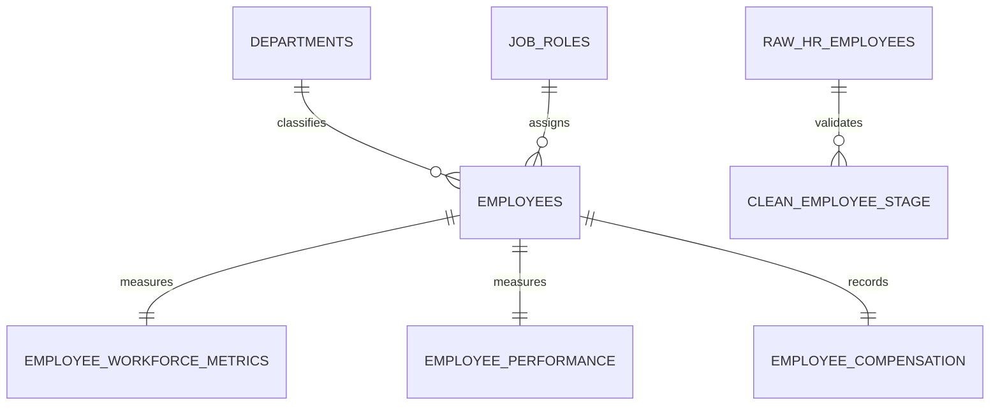

# PostgreSQL schema and data grain

The source is a single synthetic CSV, not a source relational database. The schema below normalizes it for quality control and analytical joins; it does not imply that the source was originally relational.

| Table/view | Grain | Keys / constraints | Purpose |
|---|---|---|---|
| `raw_hr_employees` | One CSV row | All source values as text | Faithful import, parse audit and reproducible reload. |
| `departments` | One normalized department | `department_id` PK; `department_name` unique | Department dimension derived from source values. |
| `job_roles` | One normalized job title | `job_role_id` PK; `job_title` unique | Job-role dimension derived from source values. |
| `employees` | One employee ID | `employee_id` PK; dimension FKs; range checks | Employee profile and observed `resigned` target. |
| `employee_workforce_metrics` | One employee ID | Employee PK/FK; nonnegative/range checks | Workload, training, promotion, remote-work and engagement fields. |
| `employee_performance` | One employee ID | Employee PK/FK; score range check | Performance rating. |
| `employee_compensation` | One employee ID | Employee PK/FK; nonnegative salary | Monthly salary. |
| `clean_employee_stage` | One deduplicated source employee ID | `row_n` from `ROW_NUMBER()` | Typed staging rows with explicit parse and category rules. |
| `v_employee_abt` | One employee ID | Key uniqueness verified | One-to-one `INNER JOIN`s to required dimensions and `LEFT JOIN`s to child tables. |
| `v_hr_dashboard_department` | One department | Aggregate | Dashboard-safe department KPIs; no employee keys. |

The four employee-grain tables are one-to-one by `employee_id`. SQL checks reconcile employees, ABT rows, resignation totals and salary totals. Tableau Public should use aggregate views only; never connect `employee_abt.csv`, `salary_rank_local.csv`, or `attrition_predictions_local.csv`.
